# Lex Operations API Reference

This document describes the FastAPI routes used by the portfolio's MongoDB and Lex
operations dashboard.

## Endpoint Flow

```mermaid
flowchart LR
    status["Check Status"] --> target["Choose Database and Collection"]
    target --> extract["Extract Document Text"]
    extract --> review["Review Text"]
    review --> preview["Preview Chunks"]
    preview --> store["Chunk, Embed, and Store"]
    store --> index["Create or Update Vector Index"]
    index --> search["POST /api/search"]
    search --> rerank["POST /api/rerank"]
    rerank --> scores["Display Both Scores"]
```



The API supports selected database and collection targets so the operations dashboard can be
used across multiple RAG projects.

## Target Selection

Read endpoints use query parameters:

```text
?database=RAG_with_MongoDB&collection=profile_chunks
```

Write/search endpoints use JSON body fields:

```json
{
  "mongodb_db": "RAG_with_MongoDB",
  "mongodb_collection": "profile_chunks"
}
```

If no target is supplied, the app uses `MONGODB_DB` and `MONGODB_COLLECTION` from
the project `.env`.

## Endpoint Summary

| Method | Path | Use It For |
| --- | --- | --- |
| `GET` | `/` | Open the Lex MongoDB operations dashboard. |
| `GET` | `/api/metrics` | Read owner-protected operation latency, stage timing, token estimates, and result counts. |
| `GET` | `/api/status` | Check config diagnostics, MongoDB connectivity, document count, and vector indexes. |
| `GET` | `/api/mongodb/databases` | List databases visible to the configured MongoDB user. |
| `GET` | `/api/mongodb/collections` | List collections in a selected database. |
| `GET` | `/api/mongodb/collection/summary` | Inspect collection count, regular indexes, search indexes, sample fields, source IDs, and titles. |
| `POST` | `/api/index/create` | Create or check the MongoDB Vector Search index for a selected collection. |
| `POST` | `/api/document/extract/upload` | Extract text from a browser-uploaded document sent as base64. |
| `POST` | `/api/document/extract/path` | Extract text from a local file path on the same machine as the running app. |
| `POST` | `/api/document/chunks` | Preview chunks before spending embedding calls or writing to MongoDB. |
| `POST` | `/api/index/document` | Chunk reviewed text, embed chunks, replace existing chunks for the same `source_id`, store vectors, and create/check the vector index. |
| `POST` | `/api/search` | Embed a query and return MongoDB vector-ranked chunks above the selected score threshold. |
| `POST` | `/api/rerank` | Rerank existing candidate chunks and return all candidates with both scores. |
| `POST` | `/api/ask` | Retrieve/rerank evidence, generate a grounded answer, and return validated citations. |

## Document Extraction

### `POST /api/document/extract/upload`

Use this when a browser or hosted client uploads the document content.

Request:

```json
{
  "filename": "profile.pdf",
  "content_base64": "BASE64_DOCUMENT_BYTES"
}
```

Response:

```json
{
  "document": {
    "filename": "profile.pdf",
    "extension": ".pdf",
    "title": "profile",
    "source_id": "profile",
    "characters": 12000,
    "text": "Extracted text..."
  }
}
```

### `POST /api/document/extract/path`

Use this for local testing only. A hosted deployment cannot read files from your PC.

Request:

```json
{
  "file_path": "C:/path/to/document.docx"
}
```

## Chunk Preview

### `POST /api/document/chunks`

Use this before embedding so a user can inspect chunk count, chunk IDs, metadata,
and text quality.

Request:

```json
{
  "title": "Smoke Document",
  "source_id": "smoke-document",
  "text": "Reviewed document text..."
}
```

Response:

```json
{
  "source_id": "smoke-document",
  "title": "Smoke Document",
  "chunk_count": 1,
  "chunks": [
    {
      "chunk_id": "stable_chunk_id",
      "source_id": "smoke-document",
      "metadata": {
        "title": "Smoke Document",
        "chunk_index": 0,
        "source_id": "smoke-document"
      },
      "characters": 200,
      "text": "Chunk text..."
    }
  ]
}
```

## Chunk, Embed, And Store

### `POST /api/index/document`

This is the MVP1 ingestion write endpoint. It is named `index/document`, but its
actual job is the full chunk, embed, and store flow.

Backend behavior:

1. Split reviewed document text into chunks.
2. Embed each chunk with the configured provider.
3. Delete existing chunks with the same `source_id` in the selected collection.
4. Insert replacement chunk records with embeddings.
5. Create/check the MongoDB Vector Search index.

Request:

```json
{
  "mongodb_db": "RAG_with_MongoDB",
  "mongodb_collection": "profile_chunks",
  "title": "Smoke Document",
  "source_id": "smoke-document",
  "text": "Reviewed document text..."
}
```

Response:

```json
{
  "source_id": "smoke-document",
  "title": "Smoke Document",
  "chunks_created": 1,
  "embeddings_created": 1,
  "inserted": 1,
  "embedding_provider": "voyage",
  "embedding_model": "voyage-context-4",
  "mongodb_db": "RAG_with_MongoDB",
  "mongodb_collection": "profile_chunks",
  "vector_index": "profile_vector_index",
  "index_result": {}
}
```

## Vector Index

### `POST /api/index/create`

Use this to create or check the selected collection's vector index.

Request:

```json
{
  "mongodb_db": "RAG_with_MongoDB",
  "mongodb_collection": "profile_chunks"
}
```

The expected MVP1 filter paths are:

```text
metadata.source_id
metadata.title
metadata.section
chunk_id
```

For a reproducible index closeout, use:

```powershell
python scripts\update_vector_index.py --database RAG_with_MongoDB --collection profile_chunks --wait
```

## Vector Search

### `POST /api/search`

Use this to embed a query and retrieve ranked chunks from MongoDB Vector Search.

Request:

```json
{
  "mongodb_db": "RAG_with_MongoDB",
  "mongodb_collection": "profile_chunks",
  "query": "What does the smoke document verify?",
  "top_k": 10,
  "min_score": 0.6,
  "num_candidates": 150,
  "exact": false,
  "source_id_filter": "smoke-document",
  "title_filter": "",
  "section_filter": "",
  "chunk_id_filter": ""
}
```

Response:

```json
{
  "query": "What does the smoke document verify?",
  "top_k": 10,
  "min_score": 0.6,
  "num_candidates": 150,
  "exact": false,
  "filters": {
    "metadata.source_id": "smoke-document"
  },
  "embedding_provider": "voyage",
  "embedding_model": "voyage-context-4",
  "mongodb_db": "RAG_with_MongoDB",
  "mongodb_collection": "profile_chunks",
  "result_count": 1,
  "results": [
    {
      "chunk_id": "stable_chunk_id",
      "source_id": "smoke-document",
      "text": "Chunk text...",
      "metadata": {},
      "score": 0.75
    }
  ]
}
```

`top_k` is the maximum number of results returned. `min_score` can reduce the actual
result count. `num_candidates` controls the approximate nearest-neighbor candidate
pool MongoDB considers before returning the final results. `exact=true` uses exact
nearest-neighbor search and omits `num_candidates`.

## Candidate Reranking

### `POST /api/rerank`

Use this after `/api/search`. It accepts a question and the existing candidate
records, calls the configured reranker, and returns every candidate in reranked
order. This comparison endpoint deliberately does not select the best 3-5.

```json
{
  "question": "What does the profile agent use MongoDB for?",
  "candidates": [
    {
      "source_id": "profile-agent-test",
      "chunk_id": "stable_chunk_id",
      "title": "Profile Agent",
      "section": "Architecture",
      "text": "MongoDB stores vectorized profile knowledge...",
      "score": 0.74
    }
  ]
}
```

The response includes `candidate_count`, `result_count`, `return_all`, provider
diagnostics, and `results`. Every candidate keeps its input fields and adds
`vector_score`, `rerank_score`, and `rerank_position`.

The Streamlit client calls this endpoint automatically after `/api/search`, so one
query submission produces both scores. If reranking fails, vector results remain
visible with the provider error and a retry control.

## Grounded Answer

### POST /api/ask

FastAPI exposes this route through the existing answer handler. It embeds the query, retrieves candidates, reranks them, selects up to five evidence chunks, calls the configured chat provider, and validates evidence markers against trusted source/chunk records.

Request fields: query (required), top_k, min_score, num_candidates, exact, and optional retrieval filters. The portfolio must omit MongoDB database/collection overrides. Public deployment must constrain this route to the reviewed profile collection server-side.

Successful responses include query, answer, citations, insufficient_evidence, candidate_count, reranked_count, evidence_count, evidence, and ranked results. Each citation resolves an evidence ID to source_id, chunk_id, title/section, vector_score, and rerank_score.

If no candidates qualify, the endpoint returns a cautious insufficient-evidence answer and empty citations. Provider/configuration failures return an HTTP error; the website should show a retryable message and may use its clearly labeled local fallback. Do not render raw exception details to visitors.

The route is implemented, but route-specific FastAPI parity/OpenAPI assertions and
successful live chat-provider acceptance still need verification. On 2026-10-25, a
pre-fix live request reached the OpenAI adapter but returned HTTP 502 because the
API project did not have access to `gpt-5-mini` (`model_not_found`). A retry with
accessible `gpt-5.1` reached generation but failed response parsing with `The model
response must be a JSON object.` No answer or citations were accepted. The workflow
now requests the typed `GroundedAnswer` schema through LangChain structured output,
then retains the existing evidence/citation validator. This patch has only passed a
syntax check; focused and live retests are pending. Verify each provider separately;
safe diagnostics only show configuration and key presence.

## Required FastAPI Migration Notes

Port the existing paths first so the current UIs remain compatible. These clearer
names may be introduced later as versioned aliases without changing retrieval services:

| Current Starlette Route | Possible Versioned Alias |
| --- | --- |
| `/api/index/document` | `/api/rag/ingest` or `/api/documents/ingest` |
| `/api/search` | `/api/rag/search` |
| `/api/index/create` | `/api/rag/index` |
| `/api/document/chunks` | `/api/documents/chunks` |

The core behavior stays framework-independent. The FastAPI `/api/ask` route and
provider-backed synthesis are implemented; route-specific contract assertions and
live-provider acceptance remain required before the chat integration is considered
verified.
