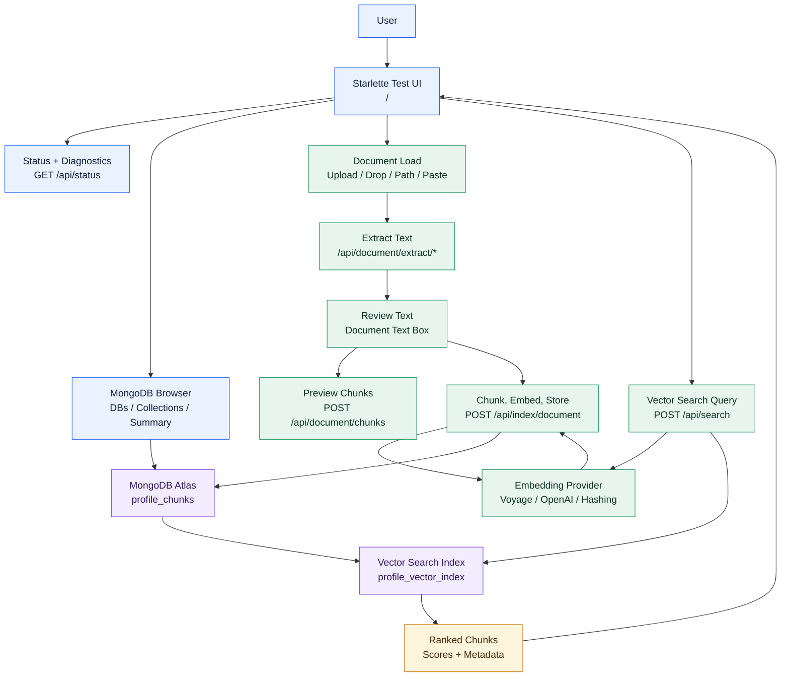
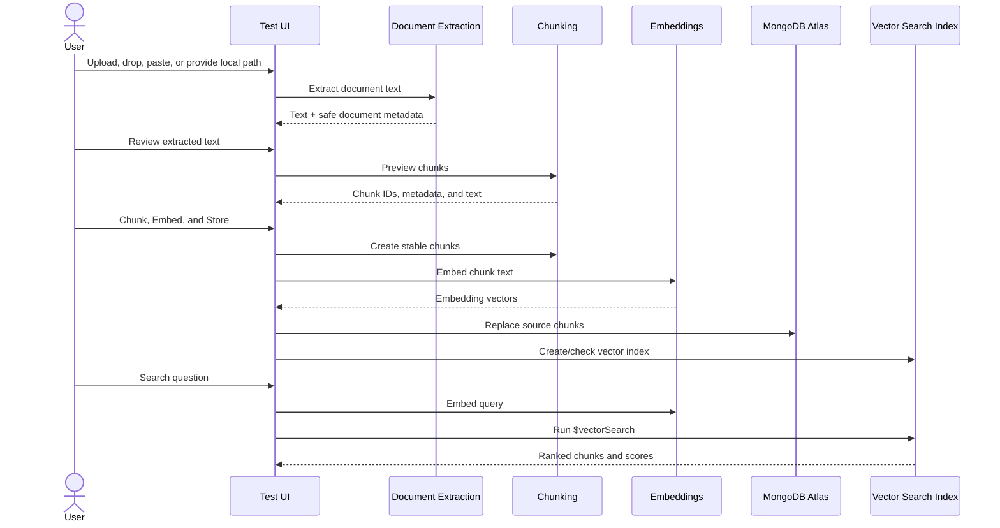
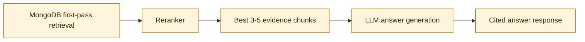

# MVP1 Architecture - MongoDB RAG Lab

MVP1 proves the retrieval foundation before adding LLM reasoning. It is a local test UI and API lab that can ingest documents, extract text, chunk content, create embeddings, store vectors in MongoDB Atlas Vector Search, and retrieve the most similar chunks for a query.

## MVP1 Goal

Build a reproducible document-to-vector-search pipeline for the Profile Assistant/Profile Agent project.

MVP1 answers one question:

```text
Can we reliably turn documents into searchable MongoDB vector chunks and retrieve the best matching context?
```

## Current MVP1 Status

- Status: functional and locally smoke-tested
- UI: Starlette browser test UI
- Database: MongoDB Atlas
- Embeddings: Voyage through MongoDB Atlas Model API
- Retrieval: MongoDB `$vectorSearch`
- DB/collection browsing: included for reusable RAG testing across multiple databases and collections
- Retrieval controls: `top_k`, minimum score, `numCandidates`, exact mode, and indexed filters
- LLM answer generation: out of scope for MVP1
- Reranking: not part of the MVP1 acceptance boundary; implemented immediately
  afterward as the first MVP2 increment

## Framework Decision

MVP1 uses Starlette instead of FastAPI as a pragmatic local-environment decision. The
first FastAPI/Pydantic path was blocked by a Windows Application Control policy that
prevented `pydantic_core` from loading. Starlette allowed the project to keep a small
ASGI API and browser test UI without requiring Pydantic at runtime.

The verified MVP1 implementation remains available only as a comparison baseline.
FastAPI is the required API framework for the hosted service, LLM answering,
citations, and future tool-style endpoints. Existing retrieval and reranking
services will be reused behind typed FastAPI routes.

## System Context



```text
User
  -> Test UI
     -> document extraction endpoint
     -> chunk preview endpoint
     -> chunk/embed/store endpoint
     -> vector search endpoint
  -> MongoDB Atlas collection
     -> vector search index
  -> returned ranked chunks and scores
```

## Runtime Components

| Component | File | Responsibility |
| --- | --- | --- |
| FastAPI app | `src/mongodb_vector_test_ui/api/fastapi.py` | Primary API and OpenAPI surface. |
| Starlette fallback | `src/mongodb_vector_test_ui/api/starlette.py` | Preserves the verified MVP1 handlers and browser UI. |
| Document extraction | `src/mongodb_vector_test_ui/ingestion/documents.py` | Extracts text from TXT, Markdown, CSV, JSON, HTML, DOCX, and PDF files. |
| Chunking | `src/mongodb_vector_test_ui/chunking/service.py` | Splits extracted text into stable chunk records. |
| Embeddings | `src/mongodb_vector_test_ui/embeddings/providers.py` | Creates query/document embeddings through Voyage, OpenAI, or local hashing fallback. |
| Vector store | `src/mongodb_vector_test_ui/vectorstore/mongodb.py` | Creates/searches MongoDB Vector Search indexes and writes chunk records. |
| Config diagnostics | `src/mongodb_vector_test_ui/core/config.py` | Loads `.env` and exposes non-secret configuration diagnostics. |
| Env check | `scripts/check_env.py` | Verifies MongoDB and embedding environment setup without printing secrets. |
| Vector index update | `scripts/update_vector_index.py` | Creates or updates the Atlas Vector Search index from the shared MVP1 definition and waits for readiness. |

See `docs/architecture/project-structure.md` for the full repository layout.

## Data Flow



### 1. Document Load

Supported MVP1 entry points:

- drag/drop upload
- file picker upload
- local file path
- manually pasted text

The selected MongoDB database and collection can be changed in the UI before indexing or searching. This makes the lab reusable across multiple RAG experiments without editing `.env`.

Supported file types:

- `.txt`
- `.md`
- `.markdown`
- `.csv`
- `.json`
- `.log`
- `.html`
- `.htm`
- `.docx`
- `.pdf`

Output:

```json
{
  "filename": "profile.pdf",
  "extension": ".pdf",
  "title": "profile",
  "source_id": "profile",
  "characters": 12000,
  "text": "Extracted text..."
}
```

### 2. Text Review

The extracted text is shown in the `Document Text` box before any embedding call runs. This keeps MVP1 inspectable and avoids spending embedding calls on bad extraction output.

### 3. Chunk Preview

The UI can call `/api/document/chunks` before storage. This allows a user to inspect:

- chunk count
- chunk IDs
- chunk text
- chunk metadata

### 4. Chunk, Embed, Store

The UI calls `/api/index/document` with title, source ID, and reviewed text.

Backend steps:

1. Split text into chunks.
2. Embed each chunk using the configured embedding provider.
3. Delete old chunks with the same `source_id`.
4. Insert replacement chunks with embeddings.
5. Create/check the MongoDB Vector Search index.

### 5. Vector Search

The UI calls `/api/search`.

Backend steps:

1. Embed the query.
2. Run MongoDB `$vectorSearch` with the selected `top_k`, score threshold, candidate count, exact mode, and compatible filters.
3. Project `vectorSearchScore`.
4. Remove results below the configured minimum score.
5. Return ranked chunks with scores.

Current ranking is MongoDB vector similarity ranking. No LLM interprets the results in MVP1.

MVP1 defaults to `min_score=0.6`. This means the API can return fewer than `top_k` results when weak matches fall below the threshold.

## Retrieval Controls

| Control | Purpose | MVP1 Default |
| --- | --- | --- |
| `top_k` | Maximum number of results to return after scoring. | `5` |
| `min_score` | Hide matches below this `vectorSearchScore`. | `0.6` |
| `num_candidates` | ANN candidate pool MongoDB considers before returning `top_k`. | `150` |
| `exact` | Use exact nearest-neighbor search instead of ANN. | `false` |
| Source ID filter | Restrict retrieval to one or more `metadata.source_id` values. | empty |
| Section filter | Restrict retrieval to one or more `metadata.section` values. | empty |
| Title filter | Restrict retrieval to one or more `metadata.title` values when indexed. | empty |
| Chunk ID filter | Restrict retrieval to one or more `chunk_id` values when indexed. | empty |

Filtering only works for fields present as `filter` fields in the selected MongoDB Vector Search index. The current live `profile_vector_index` now supports the full MVP1 filter set: `metadata.source_id`, `metadata.title`, `metadata.section`, and `chunk_id`.

## MongoDB Record Shape

```json
{
  "chunk_id": "stable chunk id",
  "source_id": "document-source-id",
  "text": "Chunk text",
  "metadata": {
    "title": "Document title",
    "chunk_index": 0,
    "source_id": "document-source-id"
  },
  "embedding": [0.01, 0.02]
}
```

## API Surface

Full examples are in `docs/api-reference.md`.

| Method | Path | Inputs | Output Evidence | Purpose |
| --- | --- | --- | --- | --- |
| `GET` | `/` | none | HTML page | Render the local browser test UI. |
| `GET` | `/api/status` | optional `database`, `collection` query params | config diagnostics, `mongo_ok`, document count, index list | Confirm the app can read config and reach MongoDB. |
| `GET` | `/api/mongodb/databases` | none | visible database names | Browse databases available to the configured MongoDB user. |
| `GET` | `/api/mongodb/collections` | `database` query param | collection names | Browse collections in a selected database. |
| `GET` | `/api/mongodb/collection/summary` | `database`, `collection` query params | document count, regular indexes, search indexes, sample fields, source IDs, titles | Inspect whether a selected collection is usable for RAG testing. |
| `POST` | `/api/index/create` | optional `mongodb_db`, `mongodb_collection` JSON fields | desired index definition, existing/missing filter paths, current indexes | Create or check the selected collection's vector index. |
| `POST` | `/api/document/extract/upload` | `filename`, `content_base64` | extracted text, title, source ID, extension, character count | Extract text from a browser-uploaded document. |
| `POST` | `/api/document/extract/path` | `file_path` | extracted text, title, source ID, extension, character count | Extract text from a local file path during local testing. |
| `POST` | `/api/document/chunks` | `title`, `source_id`, `text` | chunk count, chunk IDs, metadata, chunk text | Preview chunks before embedding/storage. |
| `POST` | `/api/index/document` | `title`, `source_id`, `text`, optional MongoDB target fields | chunks created, embeddings created, inserted count, embedding model, index result | Run the full chunk, embed, and store flow for reviewed text. |
| `POST` | `/api/search` | `query`, `top_k`, `min_score`, `num_candidates`, `exact`, optional filters and MongoDB target fields | result count, ranked chunks, metadata, scores | Embed a query and return vector-ranked chunks. |

`/api/index/document` is the important write endpoint for ingestion. The name can
sound like it only creates an index, but the route actually chunks the reviewed text,
embeds every chunk, replaces prior chunks for the same `source_id`, stores the new
vectors in MongoDB, and creates/checks the vector index.

## MVP1 Boundaries

Included:

- document extraction
- chunking
- embeddings
- MongoDB vector index creation/check
- MongoDB database and collection browsing
- vector storage
- vector retrieval
- UI smoke testing
- environment diagnostics
- audit logging

Deferred:

- LLM-generated answers
- reranker model integration (completed after MVP1 through `POST /api/rerank`)
- multi-turn chat memory
- agent tool calling
- production authentication
- hosted deployment hardening
- document access control
- source-level permissions

## Verification Baseline

The current verified baseline:

- `pytest`: `11 passed`
- `ruff check .`: passed
- path extraction endpoint: passed
- upload extraction endpoint: passed
- chunk preview endpoint: passed
- `Chunk, Embed, and Store`: inserted a Voyage-embedded chunk into MongoDB
- vector search: returned the smoke document as the top result
- MongoDB browser endpoint smoke: found visible databases, collections, document count, and search index summary
- retrieval-control smoke: `min_score=0.6`, `numCandidates=150`, source ID filter, exact mode, title filter, and chunk ID filter passed
- live Atlas index closeout: `profile_vector_index` is `READY`, queryable, and includes `metadata.source_id`, `metadata.title`, `metadata.section`, and `chunk_id`
- reusable-template smoke: second collection `mvp1_template_smoke_chunks` passed ingestion, index readiness, plain retrieval, source/title filtering, and chunk ID filtering

## MVP2 Preview

MVP2 should add:

- reranking after MongoDB first-pass retrieval
- LLM grounded answer generation
- concise cited responses
- `/api/ask` or `/api/chat` endpoint
- source traceability
- answer quality checks

The key architecture shift in MVP2 is:


