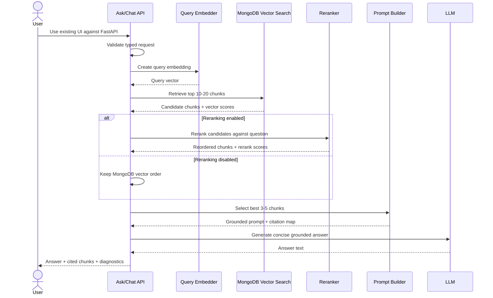

# MVP2 - FastAPI, Reranking, And Grounded LLM Answers

MVP2 begins by porting the verified MVP1 route contract to FastAPI and proving that
both existing UIs still work. Only after that acceptance gate does MVP2 turn the
retrieved and reranked chunks into concise, cited LLM answers.

MVP1 now includes retrieval-quality controls. MVP2 should consume those controls instead of replacing them: retrieve a larger high-quality candidate set, optionally rerank, select the best evidence chunks, and then call the LLM.

## MVP2 Goal

Deploy a typed FastAPI service that preserves the existing retrieval contract, works
with both current UIs, retrieves context from MongoDB Vector Search, reranks and
selects evidence, and passes that evidence into an LLM for a grounded answer.

## Proposed Flow

```mermaid
flowchart LR
    clients["Existing Browser + Streamlit UIs"] --> fastapi["Required FastAPI Contract"]
    fastapi --> question["User Question"]
    question --> qembed["Embed Query"]
    qembed --> retrieval["MongoDB Vector Search<br/>Top 10-20 Chunks"]
    retrieval --> rerank{"Rerank Enabled?"}
    rerank -->|Yes| reranker["Voyage Rerank<br/>or Provider Adapter"]
    rerank -->|No| vectorRank["Keep Vector Score Order"]
    reranker --> selected["Select Best 3-5 Chunks"]
    vectorRank --> selected
    selected --> prompt["Grounded Prompt Builder"]
    prompt --> llm["OpenAI LLM<br/>Answer Generation"]
    llm --> answer["Concise Answer<br/>with Citations"]
    answer --> api["/api/ask or /api/chat Response"]

    classDef retrievalLayer fill:#e8f5ef,stroke:#1f8f5f,color:#0d2f22;
    classDef reasoningLayer fill:#fff4dc,stroke:#c47a12,color:#3d2604;
    classDef apiLayer fill:#eaf2ff,stroke:#2563eb,color:#0f1f3d;
    class question,api apiLayer;
    class qembed,retrieval,rerank,reranker,vectorRank,selected retrievalLayer;
    class prompt,llm,answer reasoningLayer;
```



## MVP2 Sequence



## Proposed API

```http
POST /api/ask
```

Request:

```json
{
  "question": "What experience does Jabulani have with data engineering?",
  "top_k": 10,
  "min_score": 0.6,
  "num_candidates": 200,
  "source_id_filter": "career-profile",
  "rerank": true,
  "answer_style": "concise"
}
```

Response:

```json
{
  "answer": "Concise grounded answer.",
  "citations": [
    {
      "source_id": "career-profile",
      "chunk_id": "abc123",
      "title": "Master Career Profile",
      "score": 0.82,
      "rerank_score": 0.91
    }
  ],
  "retrieval": {
    "initial_results": 12,
    "reranked_results": 5,
    "min_score": 0.6,
    "num_candidates": 200,
    "embedding_provider": "voyage",
    "reranker": "voyage-rerank",
    "llm_provider": "openai"
  }
}
```

## Reranker Options

Preferred MVP2 path:

- Voyage rerank, because Voyage embeddings are already working in this project.

Implemented foundation:

- `Reranker` protocol accepts a query and provider-neutral candidate records.
- `VoyageReranker` calls the Atlas Model API `/rerank` endpoint.
- Candidate metadata, `source_id`, `chunk_id`, and original vector score are preserved.
- Results add `vector_score`, `rerank_score`, and `rerank_position`.
- `IdentityReranker` provides a no-provider path for diagnostics and fallback tests.
- `POST /api/rerank` accepts existing retrieval candidates and returns all of them
  in reranked order without dropping source evidence.
- The Streamlit client can rerank each saved search group and compare both scores.
- New Streamlit queries automatically execute vector retrieval followed by
  reranking as one user workflow; reranking remains sequential because it consumes
  the retrieved candidates.
- Best-3-5 selection remains the next isolated task.

Fallback paths:

- OpenAI scoring pass for small result sets.
- Cohere rerank if added later.
- No reranker mode for debugging and cost control.

## LLM Options

Preferred MVP2 path:

- OpenAI API for answer generation, because it gives us a direct hosted LLM path and clear API ergonomics.

Alternative:

- Local/Hugging Face model later, once the retrieval and answer contract is stable.

## Model Provider Adapter

```mermaid
flowchart LR
    graph["LangGraph answer node"] --> adapter["ModelProviderAdapter"]
    adapter --> openai["OpenAI"]
    adapter --> anthropic["Anthropic"]
    adapter --> xai["xAI / Grok"]
    adapter --> deepseek["DeepSeek"]
    voyageEmbed["Voyage embeddings"] --> retrieval["MongoDB retrieval"]
    retrieval --> voyageRerank["Voyage reranker"]
    voyageRerank --> graph
```

The adapter returns LangChain's common chat-model interface, which LangGraph accepts
directly. Provider selection is environment-driven through `CHAT_PROVIDER`,
`CHAT_MODEL`, and either `CHAT_API_KEY` or the provider's standard API-key
variable. `CHAT_BASE_URL` supports compatible/custom endpoints when the selected
integration accepts it.

Voyage remains outside the generative branch. It performs query/document embedding
and candidate reranking. The LangGraph answer workflow invoked by `POST /api/ask`
reranks candidates, selects evidence, builds the grounded prompt, invokes the
configured LangChain chat adapter, validates the structured response, and maps
evidence labels to trusted source metadata. Insufficient evidence exits without a
model call. LiteLLM remains a later routing and budget-control layer.

### Planned Profile-Agent Tools

The profile-agent workflow is planned to expose two user-facing capabilities:

- Retrieve the approved resume for the user to view or download.
- Handle resume-email requests and job-opportunity submissions. Ask for a recipient
  email when one was not provided; validate job-posting URLs before preparing an
  opportunity email to the profile owner.

Email delivery is an external side effect: the workflow must show the recipient,
message, and attachment/link and obtain explicit user approval before sending. Tool
execution is not enabled until the resume source and mail provider are selected and
configured. These tools do not belong in the grounded-answer path by default.

## Evidence Selection And Grounding Contract

- `retrieval/evidence.py` selects unique candidates by descending `rerank_score`,
  preserves source metadata, returns at most five, and reports whether the three-item
  minimum was met. If fewer than three candidates exist, it returns those available.
- `llm/grounding.py` builds provider-neutral messages. Retrieved text is marked
  untrusted and factual claims require inline labels such as `[E1]`.
- The JSON response contract includes `answer`, `citation_ids`, and
  `insufficient_evidence`. Validation rejects unknown labels and maps accepted IDs
  to trusted source and chunk metadata.

These functions are used by `/api/ask` to select evidence, build the grounded prompt,
validate the direct-provider answer, and resolve citations to trusted source/chunk IDs.

## MVP2 Acceptance Criteria

- FastAPI imports successfully in the approved local environment.
- Existing endpoint paths are ported with typed request/response models.
- The browser UI and independent Streamlit UI pass against FastAPI.
- `/docs` and `/openapi.json` expose the service contract.
- `/api/ask` returns a concise answer.
- Response includes cited source chunks.
- Reranking can be toggled on/off.
- The UI shows the generated answer and cited chunks.
- The raw retrieval response remains inspectable for debugging.
- Tests cover prompt construction, citation mapping, and no-context behavior.
