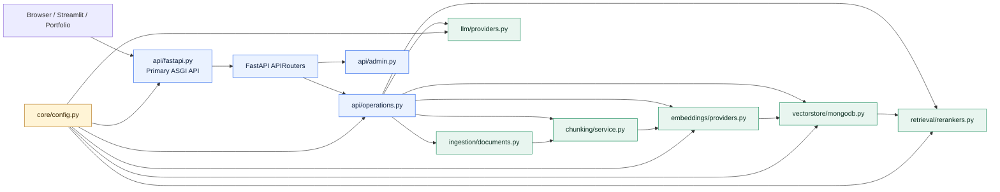

# Project Structure

The repository is organized by RAG responsibility. FastAPI is the only production
web framework, with native routers for portfolio/admin and MongoDB/RAG operations.
Domain modules do not import the web framework, so they can be reused by scripts,
tests, and future workers.

## Architecture Map



## Repository Map

```text
MongoDB_RAG/
  api/
    index.py                       # Vercel ASGI entry point
  docs/
    architecture/                  # Current architecture and MVP boundaries
    github/                        # Milestones, issues, and project-board plans
    api-reference.md
    FEATURE_LOG.md                   # Chronological capability history
    fastapi-vercel-setup.md
    project-status.md              # Current-state handoff
    test-ui-audit.md               # Chronological implementation record
  scripts/
    check_env.py
    test_reranker.py
    update_vector_index.py
  src/mongodb_vector_test_ui/
    api/
      fastapi.py                   # Primary FastAPI application
      operations.py                # FastAPI router for MongoDB/RAG dashboard routes
      admin.py                     # FastAPI router for auth, badges, and telemetry APIs
    core/
      config.py                    # Environment and safe diagnostics
    ingestion/
      documents.py                 # TXT, MD, CSV, JSON, HTML, DOCX, PDF extraction
    chunking/
      service.py                   # Deterministic paragraph-grouped chunks
    embeddings/
      providers.py                 # Voyage, OpenAI, and local hashing adapters
    vectorstore/
      mongodb.py                   # Atlas index, storage, browsing, vector search
    retrieval/
      rerankers.py                 # Provider-neutral reranking and Voyage adapter
    llm/
      providers.py                 # LangChain-compatible chat provider factory
  templates/document-vector-pipeline/
    streamlit_app.py               # Reusable HTTP evaluation client
    docs/
    scripts/
  tests/                            # Unit and API contract tests
  .env.example
  .gitignore
  compose.yaml
  Dockerfile
  pyproject.toml
  README.md
  vercel.json
```

## API Ownership

- Run `mongodb_vector_test_ui.api.fastapi:app` for local development, Docker, and
  production deployment.
- `api/index.py` exports that same FastAPI app for Vercel.
- `api/operations.py` and `api/admin.py` expose native FastAPI `APIRouter` instances
  included by the primary app; there is no separate Starlette application or route table.
- Middleware, OpenAPI documentation, CORS, authentication, operation timing, and
  endpoint registration are owned by the FastAPI application.

## Deliberately Omitted

- No generic `utils/` package: helpers remain with the domain that owns them.
- No committed `logs/` directory: runtime logs belong in stdout or the hosting
  platform, not source control.
- No empty `prompts/` package: grounded-answer prompts will be added with `/api/ask`.
- No root `main.py`: the explicit ASGI paths avoid a second ambiguous entry point.
- The reference GIF is not copied into the repository because it is design input,
  not a runtime or documentation dependency.

## Publishing Hygiene

Do not commit `.env`, `.venv/`, `.uv-cache/`, Python caches, test caches, generated
package metadata, private documents, or local logs. Keep `.env.example`, tests,
architecture decisions, and reproducible operational scripts under version control.

Historical paths in `docs/test-ui-audit.md` are intentionally preserved because
that file records what existed when each event occurred. Current paths are defined
by this document and `docs/project-status.md`.
