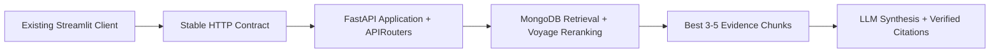

# FastAPI And Vercel Setup

FastAPI is the only API framework used by this project and its Vercel deployment.
The legacy Starlette implementation has been replaced by FastAPI routers while
existing HTTP paths are preserved for the Streamlit client.

## Migration Boundary

- `src/mongodb_vector_test_ui/api/fastapi.py` is the only ASGI application.
- `src/mongodb_vector_test_ui/api/operations.py` and `admin.py` expose native
  FastAPI routers included by the application.
- Existing HTTP route paths are preserved; the operations router also instruments
  query, retrieval, reranking, and indexing requests for MongoDB telemetry.
- Domain modules live under `core/`, `ingestion/`, `chunking/`, `embeddings/`,
  `vectorstore/`, `retrieval/`, and `llm/`; they are not tied to either web framework.
- Keep the current route paths and response evidence fields so the existing browser
  and Streamlit UIs remain reusable.



## Clean Windows Setup

Use a fresh environment instead of repairing or copying an old `.venv`:

```powershell
cd "C:\Users\Jabulani Ndlovu\Downloads\Project Folder\Project Folder\Idea_Not_Started\MongoDB_RAG"
py -3.12 -m venv .venv
.\.venv\Scripts\Activate.ps1
python -m pip install --upgrade pip
python -m pip install -e ".[dev]"
python -c "import fastapi, pydantic, pydantic_core; print(fastapi.__version__, pydantic.__version__)"
```

The last command is the dependency gate. Do not start the migration until it works.

### If `pydantic_core` Is Blocked

`pydantic_core` is a compiled dependency required by Pydantic and therefore by
FastAPI. Reinstalling packages cannot override a Windows Defender Application
Control or AppLocker policy.

1. Stop Python processes using the old project environment.
2. Delete `.venv` and create it again with a supported Python 3.12 installation.
3. Run the dependency gate above.
4. If Windows still blocks the `.pyd` file, ask the machine administrator to allow
   the signed package/publisher or use an approved trusted installation location.
5. If policy cannot be changed, run the project in WSL2 or Docker for local FastAPI
   development. Vercel builds the deployed application in its Linux Python runtime,
   so the local Windows DLL policy is not carried into that deployment.

Do not disable or bypass the organization policy. Use the approved FastAPI runtime
through WSL2 or Docker when the local Windows interpreter is blocked.

## Local Migration Test

Run FastAPI as the primary service:

```powershell
python -m uvicorn mongodb_vector_test_ui.api.fastapi:app --host 127.0.0.1 --port 8765 --http h11
```

Point the existing Streamlit sidebar API URL to `http://127.0.0.1:8765`, then verify:

1. API status and MongoDB target browsing.
2. Document extraction, chunk preview, embedding, and storage.
3. Vector search followed by automatic reranking.
4. Both `vector_score` and `rerank_score` remain visible.
5. FastAPI OpenAPI JSON loads at `/openapi.json` and interactive docs load at `/docs`.

### Docker Workflow

When Windows Application Control blocks the local Python executable, start both
existing test surfaces in Docker:

```powershell
docker compose build
docker compose up
```

Then open:

```text
FastAPI browser UI: http://127.0.0.1:8765/
FastAPI docs:       http://127.0.0.1:8765/docs
Streamlit UI:       http://127.0.0.1:8501/
```

The Streamlit container calls `http://api:8765` internally. MongoDB and provider
credentials are read from the local `.env`, which is excluded from the image.

## Vercel Shape

Vercel can discover an exported FastAPI instance named `app` from supported entry
files or from a custom entry point declared in `pyproject.toml`. The migration should
finish with one explicit application entry point and only runtime dependencies in
the deployment bundle.

Implemented deployment shape:

```text
api/index.py
src/mongodb_vector_test_ui/api/fastapi.py
pyproject.toml
vercel.json
```

`api/index.py` exports the FastAPI variable named `app`, which gives Vercel a
conventional ASGI entry point without duplicating application logic.

The root vercel.json already defines Python-function bundle exclusions. It does not deploy the project, configure environment secrets, implement CORS/authentication, or prove that model calls fit the selected plan's duration. Keep one deployment config and change it only when preview evidence calls for a setting such as function duration.

Set `.env` values in Vercel Project Settings rather than committing the local file.
MongoDB Atlas Network Access must allow the deployment's connection path. Keep tests,
local templates, caches, and private documents out of the function bundle.

## Implementation Order

1. Pass the required local FastAPI/Pydantic dependency gate.
2. Run unit, route-contract, browser UI, and Streamlit acceptance tests.
3. Replace compatibility request parsing with typed Pydantic models route by route.
4. Run live POST /api/ask acceptance with a real configured chat provider. The route and handler exist; this verifies the actual provider call. Include a question that needs evidence synthesized across multiple retrieved chunks.
5. Add explicit FastAPI route and OpenAPI tests for /api/ask.
6. Deploy the existing entry point to preview with server-side environment values and confirmed Atlas access.
7. Implement exact-origin CORS, server-side target restrictions, and rate/abuse controls before public portfolio requests.
8. Run hosted status, retrieval, rerank, answer, citation, insufficient-evidence, timeout, and error smoke tests.
9. Connect portfolio preview to the preview API; complete browser acceptance before promoting either deployment.

See docs/portfolio-chat-integration.md for the client contract. Only the public API base URL belongs in browser code; MongoDB and model credentials stay server-side.

Keep embedding/reranking and generation settings distinct. Voyage supplies embeddings
and reranking; CHAT_PROVIDER plus CHAT_MODEL and a server-side provider key select
the answer LLM. The adapter supports OpenAI, Anthropic, xAI/Grok, and DeepSeek when
their optional dependencies and credentials are configured. Mark a provider
production-ready only after its own live invocation and citation/no-context checks.

Vercel's Python runtime supports FastAPI and reads dependencies from pyproject.toml or requirements.txt. Python functions bundle reachable files, so keep excludeFiles patterns and runtime dependencies small. Measure /api/ask duration in preview before setting an override. See the official [Python runtime guide](https://vercel.com/docs/functions/runtimes/python), [FastAPI guide](https://vercel.com/kb/guide/ship-a-fastapi-app-on-vercel), [duration guide](https://vercel.com/docs/functions/configuring-functions/duration), and [environment variable guide](https://vercel.com/docs/environment-variables).

## Current Windows Verification Block

On 2026-09-14, `uv` created `.venv` and installed FastAPI, Pydantic, and the project,
but Windows returned `Access is denied` when launching the registered base interpreter
at `AppData\Local\Programs\Python\Python312\python.exe`. Ruff can run because it is a
separate executable, but Python tests and both local servers cannot run until this
application-control restriction is resolved through an approved administrator rule,
trusted installation, WSL2, or Docker.

## Framework Runtime

The deployment entry point is `api/index.py`, which exports the FastAPI application.
Operational and admin endpoints use FastAPI routers; there is no separate Starlette
application or Starlette route table.
