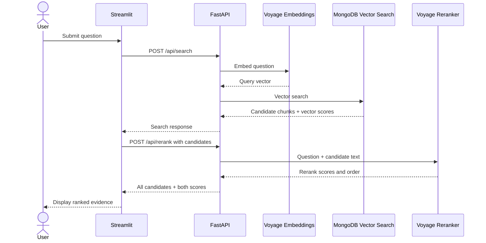

# Project Status And LLM Handoff

Last reconciled: 2026-10-31

This is the current-state source of truth. Audit files remain chronological and may
contain older failures or superseded decisions that are preserved as history.

## Current Backbone

The production system uses a native FastAPI application with `APIRouter` modules for
portfolio authentication/badges/metrics and MongoDB/RAG operations. FastAPI is the
only API application and the Vercel entry point; the retired Starlette route table
is preserved only in chronological audit documentation.

Runtime code is now grouped by responsibility under `src/mongodb_vector_test_ui/`:
`api`, `core`, `ingestion`, `chunking`, `embeddings`, `vectorstore`, `retrieval`,
and `llm`. The production launch target is
`mongodb_vector_test_ui.api.fastapi:app`.

## Delivery Snapshot

| Capability | Status | Evidence Or Remaining Work |
| --- | --- | --- |
| Document extraction and ingestion | Complete | TXT, Markdown, CSV, JSON, HTML, DOCX, and PDF flows verified. |
| MongoDB Atlas vector storage/search | Complete | Live status, index, filters, thresholding, and retrieval verified. |
| Voyage embeddings and reranking | Complete | Live search and rerank passed through FastAPI with both scores. |
| FastAPI runtime parity | Complete | Route-contract and OpenAPI tests cover the existing routes, including `POST /api/ask`. |
| Domain-oriented source structure | Complete | Runtime modules are separated by RAG responsibility; imports, Docker, Vercel, scripts, tests, and docs use the new paths. |
| Native FastAPI routers | Complete | Portfolio/admin and operations endpoints are registered through FastAPI `APIRouter` instances; there is no separate Starlette app or route table. |
| Independent Streamlit acceptance | Partially verified | Streamlit is installed in the local environment and its CLI version was verified; end-to-end UI/API acceptance remains pending. |
| Best evidence selection | Implemented | Selects unique candidates by descending `rerank_score`, returns up to five, and reports whether three were available. |
| Grounding prompt and citation contract | Implemented | Builds provider-neutral prompts and validates inline evidence IDs against trusted source/chunk records. |
| Grounded LLM answers | Structured-output fix applied; runtime verification pending | Local configuration selects `gpt-5.5`; mocked workflow tests pass, but a live provider answer and citation acceptance remain pending. |
| Google Drive source sync | Not started | Authentication, approved-folder scope, change detection, and sync endpoints remain. |
| Vercel deployment | Prepared, not deployed | api/index.py and vercel.json exist; Vercel environment, preview deployment, CORS, and hosted smoke tests remain. |
| Portfolio Agent integration | Planned, not started | Website still uses local key-value matching. Connect it to deployed /api/ask only after preview/API, CORS, rate-control, and citation checks pass. |

Architecture documentation intentionally uses only Mermaid flowcharts and sequence
diagrams: flowcharts show capability boundaries, while sequence diagrams show the
order and dependency of API calls.

```mermaid
flowchart LR
    ui["Streamlit Query UI"] --> api["FastAPI Service"]
    api --> embeddings["Voyage Query Embedding"]
    embeddings --> mongo["MongoDB Vector Search"]
    mongo --> candidates["Candidates + vector_score"]
    candidates --> reranker["Voyage rerank-2.5"]
    reranker --> compared["Candidates + vector_score + rerank_score"]
    compared --> ui
    compared --> evidence["Best 3-5 Evidence Chunks"]
    evidence --> answer["LLM Answer + Verified Citations"]
    answer -. structured-output retest pending .-> ask["POST /api/ask"]
```

## MVP1 - Complete

- Document extraction supports TXT, Markdown, CSV, JSON, HTML, DOCX, and PDF.
- Extracted text can be reviewed and chunked before embedding.
- Voyage embeddings are stored in MongoDB Atlas Vector Search.
- Database and collection browsing, index inspection, retrieval controls, and
  metadata filters are available through the reusable test UI.
- The reusable template passed against `RAG_with_MongoDB.mvp1_template_smoke_chunks`.

## MVP2 - In Progress

Completed:

- Required FastAPI application with all twelve existing route paths.
- Domain-oriented package layout with FastAPI routers isolated under `api/`.
- OpenAPI metadata and `/docs` support.
- Vercel `api/index.py` ASGI entry point and deployment exclusions.
- Route-contract/OpenAPI parity tests.
- Provider-neutral LangChain/LangGraph chat-model adapter.
- LangGraph grounded-answer workflow: rerank, select evidence, build grounding prompt,
  generate with the configured chat model, validate citations, or return an
  insufficient-evidence response without invoking the model.
- Voyage `rerank-2.5` adapter with an identity fallback.
- `POST /api/rerank` accepts a question and existing candidates.
- All candidates are returned with `vector_score`, `rerank_score`, and
  `rerank_position`; source evidence fields are preserved.
- Streamlit automatically chains vector search and reranking for each query, shows
  both scores, and retains raw search and rerank responses plus a rerun control.
- The FastAPI-hosted browser UI also automatically chains `/api/search` and
  `/api/rerank`, displays `vector_score` and `rerank_score` side by side, and keeps
  both raw responses available for inspection.

Pending verification and follow-up work:

- Run the independent Streamlit container against FastAPI after PyPI network access
  can finish its Altair/pyarrow dependency downloads.
- The active local runtime had no `CHAT_MODEL` configured at the status check. For
  isolated live calls, `gpt-5-mini` was inaccessible and `gpt-5.1` reached generation
  but failed JSON parsing before the structured-output fix.
- Run the focused structured-answer regression tests, then repeat live POST `/api/ask`
  with accessible `gpt-5.1`; verify multi-chunk synthesis, answer relevance, citation
  integrity, insufficient evidence, malformed output, and provider failure.
- Add synthesized answer and citations to Streamlit.
- Add explicit FastAPI route-parity and OpenAPI assertions for /api/ask.

## Remaining MVP2 Sequence

1. Finish typed FastAPI/Pydantic contracts without changing existing public paths.
2. Complete the independent Streamlit acceptance test against FastAPI.
3. Run focused structured-answer tests, then live `/api/ask` acceptance with an
   accessible OpenAI model; record actual answer and citation verification.
4. Add LangGraph workflow tools for resume retrieval and opportunity intake; email
   sending must use a draft-plus-explicit-approval gate.
5. Select and configure a mail provider and verify the resume source before enabling
   any email delivery.
6. Configure LiteLLM later for budget policies and Hugging Face/other provider routing.
7. Complete independent Streamlit acceptance with synthesized answers and citations.

## Website Chat And Deployment Sequence

1. Verify reviewed public profile data is current in MongoDB. Drive sync is optional if the corpus is already reviewed and ingested.
2. Run the new structured-output workflow test and repeat live POST /api/ask with accessible gpt-5.1; verify multi-chunk reasoning, citations, and insufficient-evidence output.
   Retrieval/reranking smoke results do not satisfy this gate. The LLM must synthesize
   from selected evidence and its inline citations must resolve to trusted source/chunk
   records. Test every provider advertised as verified; begin with the intended
   production provider.
3. Add route-specific test and OpenAPI assertions for /api/ask.
4. Deploy the existing FastAPI entry point to Vercel preview with server-side environment values and confirmed Atlas network access.
5. Add exact portfolio preview and production origins to backend CORS. CORS is not authentication; configure rate/abuse controls and prevent public client target overrides.
6. Run hosted status, retrieval, rerank, answer, citation, timeout, and error tests.
7. Point portfolio preview chat to preview API and complete browser acceptance. Keep local assistant fallback clearly labeled.
8. Promote API and website to production only after preview gates pass.
9. Add read-only Drive sync later if it improves corpus freshness; keep approvals, revision/checksum tracking, and credentials server-side.

See docs/portfolio-chat-integration.md for request/response and browser acceptance. This project already has vercel.json; do not create a duplicate.

## Verified Evidence

- Live `/api/status`: HTTP 200; MongoDB connected; vector index READY; Voyage
  embedding and reranker configuration present.
- Live `profile_chunks` search: three candidates above `0.6` with vector scores.
- Live `/api/rerank`: HTTP 200; all three candidates returned with both scores.
- Live Streamlit smoke on the reusable collection: `Vector 0.665` and
  `Rerank 0.445` rendered after the rerank action.
- Automatic-rerank acceptance: a fresh query rendered `Vector 0.732` and
  `Rerank 0.715` from one submission without a second action.
- Current full project test suite in the Linux API image: 25 passed.
- Full repository Ruff check and runtime compilation: passed.
- Historical MVP1 route table and API reference: all 12 legacy routes matched.
- Docker FastAPI image: built successfully with FastAPI 0.141.1, Pydantic 2.13.5,
  Pydantic Core 2.46.5, and Starlette 1.6.0.
- FastAPI root UI, `/docs`, and `/openapi.json`: HTTP 200.
- FastAPI `/api/status`: HTTP 200; MongoDB connected; 125 documents; vector index READY.
- FastAPI `/api/search` and `/api/rerank`: passed against the live Atlas collection;
  three candidates returned with vector and rerank scores.
- Vercel `api.index:app` import passed in the documented Linux validation.
- Ruff: passed across source, tests, API entry point, and Streamlit client.

## How Reranking Appears In Streamlit

A query submission first retrieves MongoDB candidates and then immediately sends
them to Voyage reranking. The result group appears with both numerical scores and
the raw responses. If reranking fails, the vector results are preserved, the error
is shown, and **Retry reranking** is available.

## Next Implementation

Complete native typed FastAPI contracts and the independent Streamlit acceptance
gate, then run live `/api/ask` acceptance using OpenAI. Add the resume/opportunity
workflow tools only after defining the resume source and email provider; all outbound
email actions require explicit approval. LiteLLM routing and budget policies follow.

## Current Handoff: Portfolio Chat

Goal: connect the Cyberpunk Portfolio assistant to this project's server-side
FastAPI `POST /api/ask`, so it can synthesize across retrieved profile chunks and
render citations that resolve to trusted source/chunk metadata. Keep the existing
local keyword matcher as a clearly labeled fallback until acceptance passes.

Current state: retrieval/reranking and the answer workflow are implemented. A typed
`GroundedAnswer` structured-output request and mocked workflow tests are in place.
The local chat model is configured as `gpt-5.5`; live provider acceptance, hosted
preview acceptance, and portfolio integration remain pending.

Next steps: verify a multi-chunk live `/api/ask` response, answer grounding, and
citation source/chunk mapping; test insufficient evidence and provider errors; address
the hosted-access risks below before deploying; then connect and browser-test a
portfolio preview. Do not mark the website chat complete before those gates pass.

## Code Review Findings Blocking Hosted Deployment

- **High:** Vercel exposes unauthenticated database browsing, caller-selected database
  and collection targets, ingestion writes, and caller-supplied server-path extraction.
  Add authorization/target restrictions and disable path extraction in hosted
  deployments before making the API public.
- **Medium:** Replacing source chunks deletes the old records before inserting the new
  chunks. Make replacement failure-safe before relying on re-ingestion.
- **Medium:** Oversized paragraphs are not split to the configured chunk limit.
  Bound chunk sizes (with a deliberate overlap policy) before indexing arbitrary
  documents.
