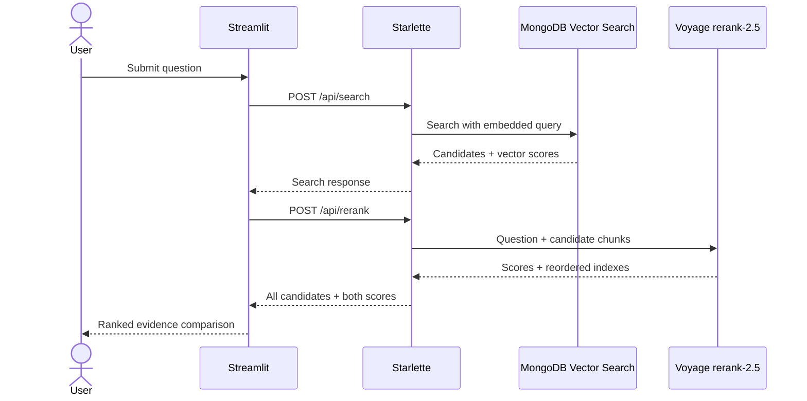

# Document to MongoDB Vector Pipeline Template

This is a reusable MVP1 setup template for projects that need to ingest documents, extract text, create chunks, generate embeddings, store vectors in MongoDB Vector Search, and expose a small UI/API surface for retrieval testing.

Use this template when starting a new RAG project so setup decisions, environment checks, and deployment fixes are recorded from day one.

## Pipeline Shape

```mermaid
flowchart LR
    source["Source Documents"] --> extract["Extract Text"]
    extract --> review["Review Text"]
    review --> chunks["Preview Chunks"]
    chunks --> embed["Embedding Provider"]
    embed --> mongo["MongoDB Collection"]
    mongo --> index["Vector Search Index"]
    index --> search["Starlette Search API"]
    search --> rerank["Voyage Reranker"]
    rerank --> ui["Streamlit Test UI"]
    ui -. later .-> agent["App, Chatbot, or Agent"]
```



## Default Stack

- Language: Python 3.11+
- API: Starlette
- Runtime server: Uvicorn
- Vector store: MongoDB Atlas Vector Search
- Embeddings: Voyage AI through MongoDB Atlas Model API, or OpenAI embeddings
- Local smoke test: deterministic hashing embeddings
- Source files: TXT, MD, Markdown, CSV, JSON, HTML, PDF, DOCX

## Framework Decision

Starlette is a safe MVP1 default when the goal is a compact local retrieval lab with
minimal runtime dependencies. In the reference project, Starlette was chosen because
Windows Application Control blocked the native `pydantic_core` DLL required by the
first FastAPI/Pydantic path.

The verified MVP1 capabilities remain available on Starlette only as a comparison
baseline. FastAPI is the required hosted API framework for typed request models,
OpenAPI documentation, LLM integration, and the final reusable service.

## Automatic Query Sequence



## Model Provider Boundary

Keep three capabilities separate in reusable RAG projects:

1. Embeddings convert documents and questions into vectors. The reference uses Voyage.
2. Reranking reorders retrieved candidates. The reference implementation uses the
   Voyage `rerank-2.5` adapter through `POST /api/rerank`.
3. A generative chat model writes the grounded answer. Configure OpenAI, Anthropic,
   xAI/Grok, DeepSeek, or another LangChain-supported chat integration.

The reference implementation is `src/mongodb_vector_test_ui/llm/providers.py`.
It returns a LangChain chat model that can be used unchanged in a LangGraph node and
delegates embedding calls to the existing Voyage/OpenAI embedding implementation.
Its provider imports are lazy, so the MVP1 Starlette lab does not require LangChain.

The reusable reranker implementation is
`src/mongodb_vector_test_ui/retrieval/rerankers.py`. Its input is a sequence of ordinary
records containing `text`, so it is not coupled to MongoDB, a vector index schema,
or the embedding model. Preserve stable source fields on each record and the adapter
will carry them through reranking.

## Files to Copy Into a New Project

```text
.env.example
PIPELINE_AUDIT.md
streamlit_app.py
requirements-streamlit.txt
docs/setup-checklist.md
docs/api-reference.md
docs/hosted-api-checklist.md
docs/reproducibility-notes.md
scripts/update_vector_index.py
scripts/smoke-test-commands.md
```

Recommended MVP1 project structure:

```text
src/<project_name>/
  api/
    fastapi.py
    starlette.py
  core/config.py
  ingestion/documents.py
  chunking/service.py
  embeddings/providers.py
  vectorstore/mongodb.py
  retrieval/rerankers.py
  llm/providers.py
scripts/
  check_env.py
  update_vector_index.py
tests/
  test_chunking.py
  test_document_extraction.py
  test_embeddings.py
docs/
  api-reference.md
  architecture/
  github/
  test-ui-audit.md
```

## MVP1 Endpoint Reference

The template expects the same endpoint behavior whether the MVP1 route layer is
implemented with Starlette or FastAPI.

| Method | Path | Plain-English Purpose |
| --- | --- | --- |
| `GET` | `/api/status` | Check config, MongoDB connection, document count, and vector indexes. |
| `GET` | `/api/mongodb/databases` | Browse databases visible to the configured MongoDB user. |
| `GET` | `/api/mongodb/collections` | Browse collections for a selected database. |
| `GET` | `/api/mongodb/collection/summary` | Inspect document count, fields, source IDs, titles, and indexes for a collection. |
| `POST` | `/api/index/create` | Create/check the selected collection's MongoDB Vector Search index. |
| `POST` | `/api/document/extract/upload` | Extract text from an uploaded document. |
| `POST` | `/api/document/extract/path` | Extract text from a local file path during local testing. |
| `POST` | `/api/document/chunks` | Preview chunks before embedding or storing. |
| `POST` | `/api/index/document` | Chunk reviewed text, create embeddings, replace existing chunks for the same `source_id`, store vectors in MongoDB, and create/check the index. |
| `POST` | `/api/search` | Embed a query and return vector-ranked chunks above the selected score threshold. |
| `POST` | `/api/rerank` | Rerank existing candidates while preserving all fields and returning every candidate. |

Read `docs/api-reference.md` before wiring a UI, hosted API, chatbot, or future MCP
tool to the template.

## Independent Streamlit Reusability Test

`streamlit_app.py` is a separate client for the Starlette API. It does not import
the RAG package or connect directly to MongoDB. A successful test therefore shows
that another UI can reuse the HTTP endpoints.

The page is named **Reusable MongoDB RAG Retrieval Lab** because this implementation
depends specifically on MongoDB Atlas browsing, collection summaries, vector indexes,
and the MongoDB-backed Starlette endpoint contract.

Start the Starlette API, then run the client in a second terminal:

```powershell
python -m pip install -r templates/document-vector-pipeline/requirements-streamlit.txt
python -m streamlit run templates/document-vector-pipeline/streamlit_app.py --server.port 8501
```

The defaults target `http://127.0.0.1:8767` and
`RAG_with_MongoDB.mvp1_template_smoke_chunks`. The source filter starts empty so
newly ingested documents remain discoverable; `mvp1-template-smoke-test` is shown
as an optional filter example. Override the target with the `RAG_API_URL`,
`RAG_TEST_DATABASE`, and `RAG_TEST_COLLECTION` environment variables.

Use the sidebar to change the target, `top_k`, minimum score, `numCandidates`,
exact-search mode, and indexed filters. The bottom chat input calls
`POST /api/search` and displays ranked chunks with score, title, source ID, chunk
ID, section, and raw response evidence. Each result group provides **Rerank
retrieved chunks**, which calls `POST /api/rerank` and displays the original
`vector_score` beside `rerank_score` for every candidate. It is a retrieval tester, not an MVP2
answer-generating chatbot.

Each query automatically runs vector search followed by Voyage reranking, then
renders both scores together. Because reranking depends on retrieved candidates,
the calls are sequential inside one user action rather than parallel. A rerun or
retry control remains available for testing and provider recovery.

The API and MongoDB connection status appears at the top of the sidebar directly
below the Starlette API URL. Database and collection controls follow, with each
load button beneath its related selector and the active retrieval target beneath
both selections.
Detailed status JSON and collection inspection remain on the main page. Ranked
results are grouped by query in collapsible sections; older queries collapse so the
newest query and its chunks remain the focus.

The document ingestion workspace exercises the remaining reusable endpoints:

1. Upload/drop a supported file, or provide a path readable by the Starlette server.
2. Extract its text through `/api/document/extract/upload` or
   `/api/document/extract/path`.
3. Review and edit the title, source ID, and extracted text.
4. Call `/api/document/chunks` to preview chunks without embeddings or database writes.
5. Call `/api/index/document` to chunk, embed, replace matching source chunks, and
   store the result in the selected MongoDB collection.
6. Query the new source through the ranked retrieval chat.

The `Chunk, embed, and store` button is the explicit write action. Reusing an
existing `source_id` replaces that source's previous chunks, so use a distinct
source ID when comparing documents.

## Environment Variables

Start from `.env.example`, then create a private `.env`. Never commit `.env`.

Minimum production-like values:

```text
MONGODB_URI=...
MONGODB_DB=...
MONGODB_COLLECTION=...
VECTOR_INDEX_NAME=...
EMBEDDING_PROVIDER=voyage
VOYAGE_BASE_URL=https://ai.mongodb.com/v1
VOYAGE_API_KEY=...
VOYAGE_MODEL=voyage-context-4
```

## First Test Order

1. Confirm local imports work.
2. Confirm `.env` diagnostics are clean.
3. Start the test UI locally.
4. Extract a document from upload or local file path.
5. Review extracted text in the UI.
6. Preview chunks without embedding.
7. Run chunk, embed, and store with real embeddings.
8. Confirm MongoDB collection receives chunks.
9. Browse the visible databases and collections.
10. Inspect the selected collection summary.
11. Create or update the vector index with the intended filter fields.
12. Confirm vector index exists, is ready, and exposes the expected filter paths.
13. Run vector search and inspect ranked chunks.
14. Deploy hosted API only after local UI/API works.

## MVP1 Acceptance Criteria

- Document text can be extracted from at least TXT and DOCX in automated tests.
- PDF extraction dependency is installed and importable.
- Chunk preview works before embedding.
- A live smoke document can be embedded and inserted into MongoDB.
- Existing MongoDB databases and collections can be browsed from the UI.
- A selected collection summary can show document count, indexes, search indexes, and sample fields.
- Retrieval can be tuned with `top_k`, minimum score, `numCandidates`, exact search, and compatible indexed filters.
- The vector index supports expected filter paths such as `metadata.source_id`, `metadata.title`, `metadata.section`, and `chunk_id`.
- Vector search returns the expected smoke document as a top result.
- README and audit logs record the verification.

## Audit Habit

Every setup or deployment attempt should add a short entry to `PIPELINE_AUDIT.md`:

- what changed
- which command ran
- what passed
- what failed
- what the next action is

This keeps the project reproducible instead of becoming a pile of remembered fixes.
