# Reusable MVP1 API Reference

Use this file when copying the document-to-vector template into a new RAG project.
It describes the endpoint behavior verified through the MVP1 Starlette baseline.
FastAPI is the required hosted-service target and must retain this reusable contract.

## Endpoint Flow

```mermaid
flowchart LR
    status["Check Status"] --> target["Choose MongoDB Target"]
    target --> extract["Extract and Review"]
    extract --> chunks["Preview Chunks"]
    chunks --> store["Embed and Store"]
    store --> index["Vector Index"]
    index --> search["Vector Search"]
    search --> rerank["Voyage Reranking"]
    rerank --> compare["Compare Both Scores"]
```



## Target Selection

Read endpoints use query parameters:

```text
?database=<mongo_db>&collection=<mongo_collection>
```

Write/search endpoints use JSON body fields:

```json
{
  "mongodb_db": "<mongo_db>",
  "mongodb_collection": "<mongo_collection>"
}
```

If no target is supplied, the app should use `MONGODB_DB` and
`MONGODB_COLLECTION` from the private `.env`.

## Endpoint Summary

| Method | Path | Use It For |
| --- | --- | --- |
| `GET` | `/` | Open the local browser test UI. |
| `GET` | `/api/status` | Check config diagnostics, MongoDB connectivity, document count, and vector indexes. |
| `GET` | `/api/mongodb/databases` | List databases visible to the configured MongoDB user. |
| `GET` | `/api/mongodb/collections` | List collections in a selected database. |
| `GET` | `/api/mongodb/collection/summary` | Inspect collection count, regular indexes, search indexes, sample fields, source IDs, and titles. |
| `POST` | `/api/index/create` | Create or check the MongoDB Vector Search index for a selected collection. |
| `POST` | `/api/document/extract/upload` | Extract text from a browser-uploaded document sent as base64. |
| `POST` | `/api/document/extract/path` | Extract text from a local file path on the same machine as the running app. |
| `POST` | `/api/document/chunks` | Preview chunks before spending embedding calls or writing to MongoDB. |
| `POST` | `/api/index/document` | Chunk reviewed text, embed chunks, replace existing chunks for the same `source_id`, store vectors, and create/check the vector index. |
| `POST` | `/api/search` | Embed a query and return MongoDB vector-ranked chunks above the selected score threshold. |
| `POST` | `/api/rerank` | Rerank existing candidates and return every candidate with both scores. |

## `POST /api/document/chunks`

Preview chunks before embedding or storage.

Request:

```json
{
  "title": "Smoke Document",
  "source_id": "smoke-document",
  "text": "Reviewed document text..."
}
```

Expected response evidence:

```text
source_id
title
chunk_count
chunks[].chunk_id
chunks[].metadata
chunks[].text
```

## `POST /api/index/document`

This is the MVP1 chunk, embed, and store endpoint. The route name says
`index/document`, but the behavior is broader than indexing alone.

Backend behavior:

1. Split reviewed document text into chunks.
2. Embed each chunk with the configured provider.
3. Delete existing chunks with the same `source_id`.
4. Insert replacement chunk records with embeddings.
5. Create/check the MongoDB Vector Search index.

Request:

```json
{
  "mongodb_db": "<mongo_db>",
  "mongodb_collection": "<mongo_collection>",
  "title": "Smoke Document",
  "source_id": "smoke-document",
  "text": "Reviewed document text..."
}
```

Expected response evidence:

```text
chunks_created
embeddings_created
inserted
embedding_provider
embedding_model
mongodb_db
mongodb_collection
vector_index
index_result
```

## `POST /api/search`

Embed a query and retrieve ranked chunks.

Request:

```json
{
  "mongodb_db": "<mongo_db>",
  "mongodb_collection": "<mongo_collection>",
  "query": "What does this document explain?",
  "top_k": 10,
  "min_score": 0.6,
  "num_candidates": 150,
  "exact": false,
  "source_id_filter": "smoke-document",
  "title_filter": "",
  "section_filter": "",
  "chunk_id_filter": ""
}
```

Expected response evidence:

```text
result_count
results[].chunk_id
results[].source_id
results[].text
results[].metadata
results[].score
```

`top_k` is the maximum result count. `min_score` may return fewer than `top_k`.
`num_candidates` tunes approximate vector search recall. `exact=true` uses exact
nearest-neighbor search and omits `num_candidates`.

## `POST /api/rerank`

Pass a question plus the candidate objects returned by `/api/search`:

```json
{
  "question": "What does this document explain?",
  "candidates": [
    {
      "source_id": "<source_id>",
      "chunk_id": "<chunk_id>",
      "title": "Document title",
      "section": "Section name",
      "text": "Candidate chunk text...",
      "score": 0.72
    }
  ]
}
```

This test endpoint always returns all candidates in reranked order. Every input
field is preserved, and each result adds `vector_score`, `rerank_score`, and
`rerank_position`. Best-3-5 selection is intentionally deferred.

The Streamlit client invokes this endpoint automatically after `/api/search`.
Successful query results therefore render both scores together; a failed rerank
keeps the vector results visible and exposes a retry action.

## Vector Index Closeout

Each reusable project should confirm the selected MongoDB Vector Search index has
the expected filter fields:

```text
metadata.source_id
metadata.title
metadata.section
chunk_id
```

Run:

```powershell
python scripts\update_vector_index.py --database <mongo_db> --collection <mongo_collection> --wait
```

Then verify the index is ready and queryable from `/api/mongodb/collection/summary`.

## Optional Route Naming

If a future deployment renames routes, these names can be considered independently
of framework choice:

| Current Route | Optional Future Name |
| --- | --- |
| `/api/index/document` | `/api/rag/ingest` or `/api/documents/ingest` |
| `/api/search` | `/api/rag/search` |
| `/api/index/create` | `/api/rag/index` |
| `/api/document/chunks` | `/api/documents/chunks` |

The implementation should keep chunking, embeddings, and vector storage in
framework-independent modules so the route layer can change without rewriting the
RAG pipeline.

## Reusability Client

The template includes `streamlit_app.py` as an independent HTTP client. It uses:

- `GET /api/status` for connectivity and target evidence
- `GET /api/mongodb/databases` and `/api/mongodb/collections` for target selection
- `GET /api/mongodb/collection/summary` for collection and index inspection
- `POST /api/search` for query embedding and ranked chunk retrieval
- `POST /api/rerank` for metadata-preserving reranker comparison

Because the Streamlit client has no imports from the Starlette app or RAG package,
it also acts as an API-boundary test. Each result references its returned title,
`source_id`, `chunk_id`, section, and score. MVP1 does not synthesize an LLM
answer from these chunks.

The same client validates the ingestion boundary without direct backend imports:

```text
upload/drop or server path
  -> extraction endpoint
  -> editable text review
  -> chunk preview endpoint (no write)
  -> index document endpoint (chunk + embed + replace source + store)
  -> search endpoint
```

The active database and collection are sent only to the write and search endpoints.
Extraction and chunk preview do not require MongoDB access.
